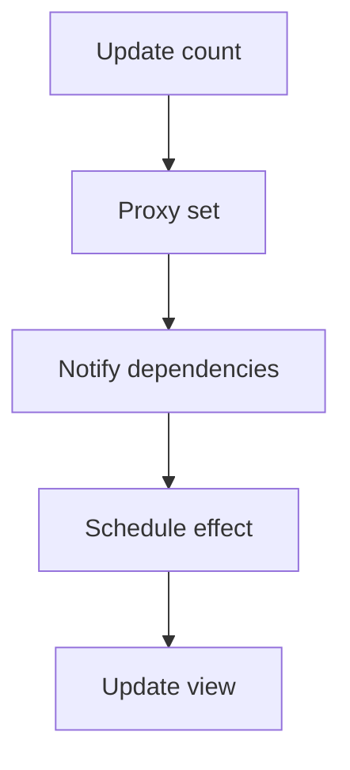

# Example conversations (English)

> These are fictional demonstrations, not the learner's real progress.

## 1. Ask a tangent before finishing the answer

**Learner:** Start learning Vue3 watch.

**Tutor:** A watch callback lets you react when a reactive value changes. Mini-task: log the text entered in an input field.
Checkpoint: watch input listener | awaiting reading

**Learner:** What's the difference between computed and watch?

**Tutor:** Parked: computed vs watch. Your original lesson is still unread. Say "Side question:" to answer now.
Checkpoint: watch input listener | awaiting reading

**Learner:** Side question: What's the difference between computed and watch?

**Tutor:** Use computed for derived values, and watch for side effects in response to changes.
Checkpoint: watch input listener | awaiting reading

**Learner:** I lost my place.

**Tutor:** We were learning watch: react to a changing input value. Your unfinished task is to log new input text. You have not confirmed reading yet.
Checkpoint: watch input listener | awaiting reading

**Learner:** I've read it.

**Tutor:** One check: when will the watcher run if an input value changes from A to B?
Checkpoint: watch input listener | awaiting assessment

**Learner:** When the observed input value changes.

**Tutor:** Right. Now try the tiny code exercise before asking to advance.
Checkpoint: watch input listener practice | awaiting practice

## 2. Distracted and returning

**Learner:** I'm back. I got pulled into short videos.

**Tutor:** Still at watch input practice. Your task was to log the updated value. Open the code file and find the input binding first.
Checkpoint: watch input listener practice | awaiting practice

The tutor cannot observe the user's phone activity or reading position.

## 3. Change language without losing progress

**Learner:** 中文模式

**Tutor:** 已切换到中文。原来的练习仍是监听输入框变化并打印新值。
断点：watch 输入监听练习｜待实践

**Learner:** English mode

**Tutor:** Switched to English. The original input-watch exercise is still unfinished.
Checkpoint: watch input listener practice | awaiting practice

## 4. Portable checkpoint

**Learner:** Save progress.

**Tutor:**

```text
[ThreadKeeper checkpoint v1]
Language: en
Main thread: Vue3 watch — log reactive input changes
Confirmed mastery: watch runs when its watched value changes (assessed)
Current step: input listener coding practice
Reading status: read; practice pending
Where I stopped: completed a short comprehension check, not the independent code task
Unfinished task: implement and verify a small input watcher
Parked questions: computed vs watch (briefly answered)
Next action: open the Vue component and find the input binding
[End checkpoint]
```

A printed checkpoint is portable text, not proof of durable storage.

## 5. Mock interview mode (v1.3)

**Learner:** Mock interview: Vue3 frontend engineer.

**Tutor:** Question 1: When should you use `computed` rather than `watch`? Answer in your own words.
Checkpoint: interview question 1 | awaiting answer

**Learner:** Side question: Is `watch` always asynchronous?

**Tutor:** Watchers are scheduled depending on configuration; they are not universally asynchronous. Your interview question remains the same.
Checkpoint: interview question 1 | awaiting answer

**Learner:** I got distracted. I'm back.

**Tutor:** We're still on question 1 about `computed` versus `watch`. Start by stating one use case for each.
Checkpoint: interview question 1 | awaiting answer

**Learner:** `computed` derives a value; `watch` runs logic when a dependency changes.

**Tutor:** Good distinction. For a stronger answer, mention that `computed` caches its result. Say `Next question` when ready.
Checkpoint: interview question 1 | ready for next

**Learner:** Save progress.

**Tutor:**

```text
[ThreadKeeper checkpoint v1]
Language: en
Mode: interview
Main thread: Vue3 frontend interview
Current question: when to use computed rather than watch
Question status: ready for next
Answer summary: computed for derived values; watch for actions on change
Feedback: mention computed caching
Next action: wait for `Next question`
[End checkpoint]
```

This fictional example does not imply native voice recording or automatic cloud access to private documents.

## 6. Terms, examples and Mermaid diagrams (v1.4, fictional)

**Learner:** Mock interview: Vue3.
**Tutor:** Question 1: Why does the view update when reactive state changes? Answer first.
Checkpoint: question 1 | awaiting answer

**Learner:** Proxy intercepts changes and notifies dependencies.
**Tutor:** Good direction. You could also describe effect scheduling. Ask for terms, an example or a flowchart.
Checkpoint: question 1 | feedback given

**Learner:** Explain terms.
**Tutor:** `Proxy` intercepts object operations; `trigger` notifies dependencies; `effect` performs reactive work.

**Learner:** Give an example.
**Tutor:** Clicking a counter button changes `count`, and the dependent display updates. This is a simplified example.

**Learner:** Show a flowchart.
**Tutor:**



Fallback: update → intercept → notify → schedule → display.
Checkpoint: question 1 | ready for next
