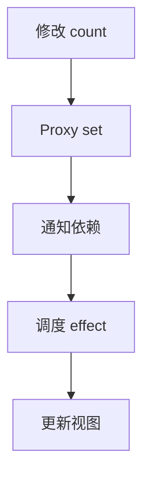

# 对话示例（虚构）

## 1. 临时插问后继续学习

**学习者**：开始学习 Vue3 watch。
**导师**：`watch` 用于在值变化时执行操作。练习：监听输入框，把新值打印到控制台。
断点：输入框监听｜待阅读

**学习者**：computed 和 watch 有什么区别？
**导师**：已暂存这个问题。你的主线仍是输入框监听；目前尚未确认读完。

**学习者**：插问：computed 和 watch 有什么区别？
**导师**：`computed` 适合派生值，`watch` 常用于响应变化后执行副作用。
断点：输入框监听｜待阅读

**学习者**：我断片了。
**导师**：刚才你要练习监听输入框并打印变化后的值。当前仍是待阅读状态。
断点：输入框监听｜待阅读

## 2. 模拟面试不会一次倾倒题库

**学习者**：模拟面试：前端开发，Vue3。
**导师**：第 1 题：`watch` 和 `computed` 分别适合什么场景？请先自己作答。
面试断点：题 1｜待作答

**学习者**：我去接了个电话，我回来了。
**导师**：我们停在第 1 题：`watch` 与 `computed` 的使用场景。你尚未作答，现在可以继续。
面试断点：题 1｜待作答

**学习者**：`computed` 用来计算衍生状态，`watch` 用来监听变化并触发操作。
**导师**：回答方向正确。可以补充 `computed` 的缓存特性，使区别更完整。需要继续时说「下一题」。
面试断点：题 1｜反馈已给出，待下一题

**学习者**：English mode
**导师**：Switched to English. Question 1 is still complete; say `Next question` to proceed.
Checkpoint: interview question 1 | ready for next

此示例不包含真实个人资料；语音输入和云端知识库权限必须由实际宿主系统实现。

## 3. 术语、案例和流程图复盘（v1.4，虚构示例）

**学习者**：模拟面试：Vue3。
**导师**：第 1 题：响应式数据变化后，视图为何会更新？请先作答。
面试断点：题 1｜待作答

**学习者**：Proxy 拦截属性修改，再通知相关依赖。
**导师**：方向正确。可以补充 effect 的调度过程。你可以请求「术语解释」「举个例子」或「画流程图」。
面试断点：题 1｜反馈已给出

**学习者**：术语解释
**导师**：`Proxy` 是对象操作拦截器；`trigger` 通知相关依赖；`effect` 代表响应式副作用逻辑。

**学习者**：举个例子
**导师**：例如按钮修改 `count` 后，依赖它的计数显示随之更新。这只是简化示例。

**学习者**：画流程图
**导师**：

文字兜底：修改 → 拦截 → 通知 → 调度 → 更新。
面试断点：题 1｜等待下一题
